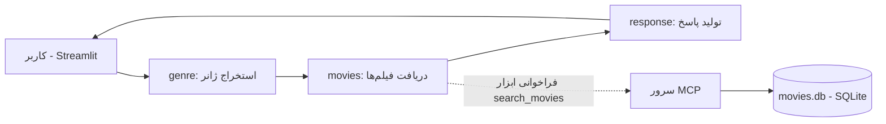

<div dir="rtl" align="right">

# 🎬 سیستم پیشنهاد فیلم با LangGraph و MCP

یک سیستم پیشنهاد فیلم فارسی‌زبان که درخواست کاربر را به زبان طبیعی دریافت می‌کند، ژانر مورد نظر را با کمک یک مدل زبانی (LLM) استخراج می‌کند، فیلم‌های مناسب را از طریق یک **سرور MCP** از پایگاه‌داده **SQLite** می‌خواند و در نهایت پیشنهادها را به سبک سرویس‌های استریم نمایش می‌دهد.

## ✨ امکانات

- دریافت درخواست به زبان فارسی و محاوره‌ای (مثلاً: «یه فیلم علمی تخیلی خفن»)
- استخراج خودکار ژانر با LLM
- جست‌وجوی فیلم‌ها بر اساس ژانر و حداقل امتیاز IMDb (پیش‌فرض: ۸.۵)
- جداسازی لایهٔ داده از منطق برنامه با استفاده از پروتکل MCP
- رابط کاربری ساده با Streamlit

## 🧠 معماری

جریان کار با **LangGraph** به‌صورت یک گراف سه‌مرحله‌ای تعریف شده است:



| گره | توضیح |
|------|--------|
| `genre` | ژانر را از پیام کاربر با LLM استخراج می‌کند (Drama، Action، Crime، Sci-Fi، Thriller) |
| `movies` | با کلاینت FastMCP ابزار `search_movies` را روی سرور MCP صدا می‌زند |
| `response` | فهرست فیلم‌ها را به LLM می‌دهد تا پیشنهاد نهایی را بنویسد |

## 📁 ساختار پروژه

```text
.
├── app.py                    # رابط کاربری Streamlit
├── graph.py                  # تعریف گراف LangGraph و گره‌ها
├── state.py                  # تعریف MovieState (وضعیت گراف)
├── llm.py                    # راه‌اندازی مدل زبانی
├── movies.db                 # پایگاه‌داده SQLite فیلم‌ها
├── .env                      # متغیرهای محیطی (کلید API و ...)
├── db/
│   └── create_db.py          # ساخت و مقداردهی اولیهٔ پایگاه‌داده
└── mcp_server/
    ├── imbd_mcp_server.py    # سرور MCP و ابزار search_movies
    └── test.py               # تست سرور MCP
```

## 🧰 پیش‌نیازها

- Python نسخهٔ ۳.۱۰ یا بالاتر
- کلید API مربوط به سرویس LLM مورد استفاده در `llm.py`

## ⚙️ نصب

```bash
git clone https://github.com/Ali-salek/langgraph-fastmcp-imdb-recommender.git
cd langgraph-fastmcp-imdb-recommender

python -m venv .venv
source .venv/bin/activate        # در ویندوز: .venv\Scripts\activate

pip install langgraph langchain fastmcp streamlit python-dotenv
```

> بسته‌ای که برای اتصال به LLM لازم است (مثلاً `langchain-openai`) به مدل انتخابی شما در `llm.py` بستگی دارد.

فایل `.env` را در ریشهٔ پروژه بسازید و کلید خود را در آن قرار دهید:

```env
API_KEY=your_api_key_here
```

## 🚀 اجرا

**۱. ساخت پایگاه‌داده** (فقط بار اول):

```bash
python db/create_db.py
```

**۲. اجرای سرور MCP** (روی `http://localhost:8000/mcp`):

```bash
python mcp_server/imbd_mcp_server.py
```

**۳. اجرای برنامه** (در ترمینال دیگر):

```bash
streamlit run app.py
```

سپس آدرسی که Streamlit نشان می‌دهد را در مرورگر باز کنید.

## 💬 نمونهٔ استفاده

| ورودی کاربر | ژانر استخراج‌شده |
|-------------|------------------|
| یه فیلم علمی تخیلی خفن | `Sci-Fi` |
| یه فیلم اکشن هیجان‌انگیز | `Action` |
| یه فیلم جنایی با داستان پیچیده | `Crime` |

خروجی: فهرستی از فیلم‌های دارای امتیاز IMDb بالای ۸.۵ در ژانر مورد نظر، با نام، سال ساخت و امتیاز.

## 🔧 شخصی‌سازی

- **تغییر حداقل امتیاز:** مقدار `min_rating` را در تابع `fetch_movies_async` در `graph.py` تغییر دهید.
- **افزودن ژانر جدید:** فیلم‌های آن را به `movies.db` اضافه کنید و نام ژانر را در پرامپت تابع `extract_genre` بیاورید.
- **تغییر مدل زبانی:** فایل `llm.py` را ویرایش کنید.

## 🗺️ ایده‌های توسعه

- پشتیبانی از چند ژانر یا فیلتر سال ساخت و کارگردان
- افزودن حافظهٔ مکالمه برای پیشنهادهای پیگیرانه
- اتصال به منبع داده‌ی واقعی IMDb

</div>
